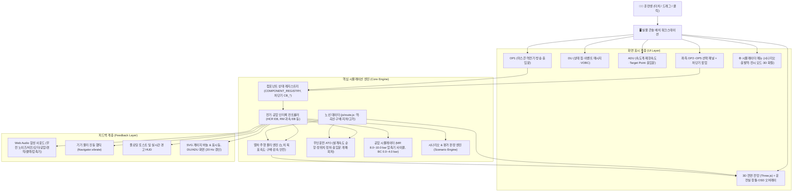

# 📋 1. 프로젝트 개요 (Project Overview)

## 1. 개발 배경 및 목적
철도 차량의 운전실 조작반은 복잡한 전기 회로와 공압 배관, 다양한 안전 보호 인터록(Interlock) 장치로 얽혀 있습니다. 
기관사 및 승무원이 실제 비상 상황(비상제동 체결, 구원운전, 차단기 트립, VOBC 리셋, 무인운전 인가 등)에서 신속하고 정확하게 대응하기 위해서는 반복적인 훈련이 필수적입니다.

그러나 실제 전동차를 기지에 유치하여 훈련하기에는 시공간적 한계와 비용이 발생합니다. 본 프로젝트는 **언제 어디서나 웹 브라우저(모바일, 태블릿, PC)만으로 실제 열차 운전실과 100% 동일한 조작 감각 및 연동 논리를 체득할 수 있는 고정밀 훈련 시뮬레이터**를 구축하는 것을 목표로 합니다.

---

## 2. 주요 설계 원칙

### ① 1:1 사진 기반 극사실적 비주얼 고증 (Photorealistic)
* 실제 전동차 운전실 실물 사진을 토대로 조작반 프레임, 볼트 고정 위치, 우측 상단 모서리 사선 절단면(Chamfer), 챔퍼 테두리 핀스트라이프 라인까지 픽셀 단위로 구현
* 금속 질감(Metallic Texture), 헤어라인 알루미늄 명판, 황동(Brass) 키 실린더, 투명 아크릴 힌지 안전커버 등 재질감 극대화
* 부품의 물리적 움직임(3-Arrow 버섯형 비상제동 버튼의 쑥 들어가는 래치, 누름 해제 시 30도 회전 튀어나옴, 대형 블랙 구형 볼 노브 역전기, T자형 원핸들 마스콘) 시각화

### ② 인천 2호선 실제 노선 기반 3D 전면 전망 (Three.js)
* 2026-10 개편으로 메인 화면(`/`)의 전면 전망은 **Three.js(r160) 기반 실제 3D**로 바뀌었습니다. 이전 Canvas 2D 의사 3D 버전은 [`/old/`](https://l2l2l2l2.github.io/study/old/)에 그대로 보관되어 있습니다.
* **실제 노선 데이터(`js/route.js`)**: 인천 2호선 **201 검단오류 ~ 227 운연 27개 역**의 역간 거리, 곡선 반경·설계속도, 구배(‰), 건넘선, 고가/지하 구간을 반영합니다. 하선(201→227)과 상선(227→201) 모두 운행할 수 있습니다.
* **터널**: 박스형·원형 터널 단면, 갱구(포털) 벽체, 터널 조명등. 지하 구간에서는 안개·노출이 어둡게 바뀌고 전조등이 벽면과 바닥을 비춥니다.
* **강우**: 노선 위치에 따라 정해진 지상 구간에서 비가 내리며, 유리창 빗방울이 흘러내리며 옅은 자국을 남기고 와이퍼(OP4)가 닦아냅니다. 지하와 고가역 지붕 아래에서는 비가 맞지 않습니다.
* **전조등(OP2)**: 하향/상향/소등에 따라 셰이더 조명으로 선로·터널·승강장을 비춥니다.
* **반대편 열차**: 기존차/신조차 전면이 번갈아 지나가며, 행선지 LED가 진행 방향(검단오류/운연)을 따릅니다.
* **정지위치 표지와 위치 태그**: 표준도면 기준 PSD 측면 표지·궤도 중앙 정지위치 표지, 25m 간격 노란 위치 태그.
* 실물 운전실 사진(`cab_view.png`)의 창틀 오버레이 너머로 3D 장면이 보이며, 주행 속도에 따른 차체 진동·캔트 롤링, 인버터 구동음, 25m 주기 레일 이음매 충격음(Clack)을 합성합니다.

### ③ 타협 없는 인터록(Interlock) 논리 구현
* **운전모드 `OFF` 상태 인터록**: 운전모드가 OFF일 때는 제어키를 ON으로 돌릴 수 없으며, 역전기(F/R) 및 마스콘(P/B) 조작이 기계적으로 차단됨
* **HCR 비상제동**: 무인운전이 아닌 상태에서 운전모드가 OFF이면 비상제동(EB)과 정차제동(HB)이 체결되어 BC 4.0 bar 유지. 수동 모드로 전환하면 EB가 완해되고, HB는 역전기 F/R + 역행 투입 시 완해
* **무인운전모드(ATO) 인가 4대 조건**: `운전모드 OFF + 제어키 OFF + 역전기 N + 마스콘 N` 상태에서 커버 오픈 후 3초 이상 롱프레스 시 녹색 점등(`LIT`). 이후 노선의 곡선 설계속도를 반영해 최고 65 km/h로 역간 주행하고, 정지위치에 정차해 출입문·PSD를 8초간 개방
* **수동 운전 조건(FM, RM, ATPM)**: 수동 모드에서만 키 ON 및 레버 수동 운전 가능. **RM(제한수동) 모드는 허용속도 15 km/h**이며 15~17 km/h가 5초 이상 지속되거나 18 km/h 이상이면 비상제동 체결
* **선두차지정 점등 연동**: `운전모드(RM/FM/ATPM) + 키(ON) + 역전기(F/R)` 3가지 조건이 모두 만족해야만 황색 점등
* **마스콘 EB 연동**: 비상제동 노치(EB) 투입 시 OP2 제동체결등 점등 및 제동통(BC) 4.0 bar 가압 연동
* **VOBC 리셋 롱프레스 취급**: 2~3초 누름 시 활성 VOBC를 반대쪽으로 전환 / 5~7초 누름 시 전·후부 VOBC 전체 리셋(VOBC1 활성, `POSITION LOST` → RM으로 위치 태그 2개 통과 시 해소) / 7초 초과 시 타임아웃 경고
* **주공기(MR)와 공기압축기**: 제동으로 BC에 공기가 들어간 만큼 MR이 줄고, 8.0 bar 이하에서 공기압축기(CM)가 기동해 10.0 bar까지 충기 (DU CMG 표시, 압축기 소리)

### ④ 가벼운 웹 기술 구성
* 3D 전면 전망만 **Three.js r160**을 사용하고, 조작반·DU·ADU·사운드는 **HTML5, CSS3, JavaScript, SVG, Canvas 2D, Web Audio API**만으로 구현했습니다. 오디오 파일 없이 모든 소리를 실시간 합성합니다.
* 3D 장면은 열차 주변 구간만 덩어리(chunk) 단위로 생성해 내장 그래픽에서도 동작하도록 했고, 프레임이 낮으면 해상도를 자동으로 낮춥니다(시뮬레이터 메뉴 `3D 화질`로 수동 선택 가능).
* 메인 버전은 `index.html`, `js/route.js`, `js/cabview3d.js`로 나뉘어 있어 GitHub Pages 같은 웹 서버로 열어야 합니다 (로컬: `python -m http.server`).

---

## 3. 시스템 아키텍처 다이어그램

