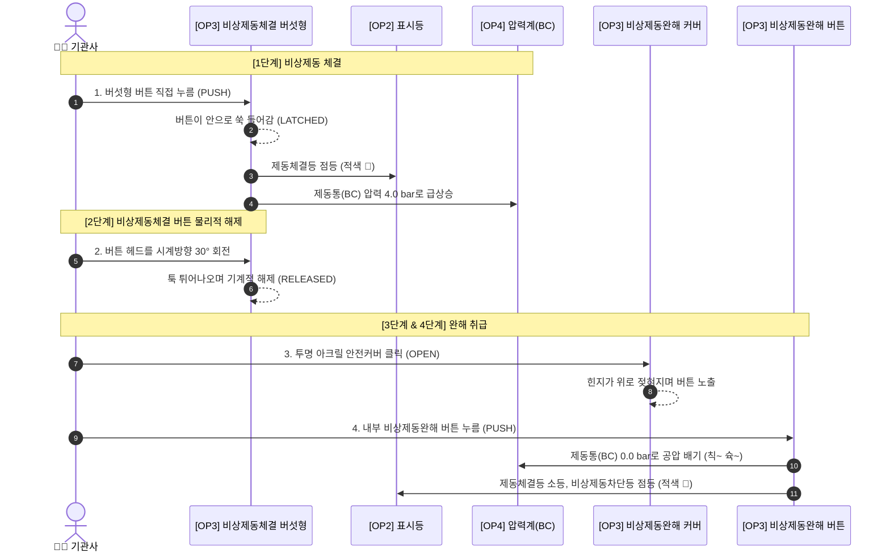

# 📖 3. 운전 취급 절차 매뉴얼 (Operating Manual)

본 매뉴얼은 실제 도시철도 운전 취급 규정에 기반하여 본 시뮬레이터에서 연습할 수 있는 핵심 절차와 인터록 제약 사항을 기술합니다.

---

## 1. 운전모드 `OFF` 상태 인터록 및 무인운전(ATO) 가동 절차

운전모드가 `OFF`일 때의 운전대 보호 인터록과 3초 롱프레스를 통한 무인운전 인가 표준 절차입니다.

### ① 운전모드 `OFF` 인터록 (운전대 잠금)
* 운전모드가 `OFF`인 상태에서는 기관사 수동 조작을 차단하기 위해 **제어키 ON 불가**, **전후진제어기(F/R) 조작 불가**, **마스콘(P1~P4, B1~B7, EB) 조작 불가** 인터록이 작동합니다.
* 운전모드를 `OFF`로 전환하면 기존에 투입되어 있던 제어키는 `OFF`로, 역전기 및 마스콘은 `N`(중립)으로 강제 복귀합니다.

### ② HCR 비상제동 (운전모드 OFF, 무인운전 아님)
* 무인운전 중이 아닌데 운전모드가 `OFF`이면 **비상제동(EB) + 정차제동(HB)**이 체결되고 BC는 4.0 bar를 유지합니다. DU에는 `MF HCR 비상제동체결`이 표시됩니다.
* `OFF`에서 RM 등 수동 모드로 돌리면 EB가 완해되고(`MCF MC1 VOBC RESET EB`, 상선은 MC2), 정차 중이면 HB는 2.0 bar로 남습니다.
* HB는 역전기 `F`/`R` + 제어키 ON 상태에서 마스콘을 역행(P)으로 넣을 때 완해되며 출발합니다.

### ③ 무인운전모드(ATO) 인가 4대 선행조건 및 3초 롱프레스
무인운전(ATO)을 가동하기 위해서는 반드시 아래의 **4대 선행조건**이 충족되어야 합니다.

```
[운전모드 = OFF] ──┐
[제어키 = OFF]   ──┼─► [OP3 무인모드 투명 안전커버 OPEN] ─► [버튼 3초 롱프레스] ─► [ATO 무인운전 가동!]
[역전기 = N]     ──┤                                                   (노선 설계속도 반영 자동 운행)
[마스콘 = N]     ──┘
```

1. OP4 운전모드가 `OFF` 위치일 것
2. OP1 제어키가 `OFF` 위치일 것
3. OP1 전후진제어기가 `N`(중립) 위치일 것
4. OP1 마스콘 핸들이 `N`(중립) 위치일 것
5. **취급 요령**:
   - OP3 `SW_WIRELESS_COVER`(무인모드 안전커버)를 클릭하여 엽니다.
   - 내부 녹색 푸시버튼(`SW_WIRELESS_MODE`)을 3초 이상 누르고 있으면 원형 프로그레스가 충전되며 녹색 불(`LIT`)이 점등합니다.
   - 4대 조건 중 하나라도 미충족 시 버튼을 눌러도 충전되지 않으며 미충족 안내 토스트가 출력됩니다.
   - `POSITION LOST` 상태에서도 인가는 되지만 열차는 출발하지 않습니다 (OP5 VOBC 리셋 항목 참고).

### ④ 무인운전 운행 동작
* **순항**: 최고 65 km/h, 앞쪽 곡선의 설계속도보다 2 km/h 낮게 자동 조절합니다. 목표보다 빠르면 제동하며, 곡선에서 BC 바늘이 떨리지 않도록 히스테리시스(+0.8 / −0.3 km/h)를 둡니다.
* **정차**: 다음 역 정지위치에 맞춰 감속·정차한 뒤 정차제동(BC 2.0 bar)을 유지합니다.
* **출입문**: 정차 후 출입문과 PSD를 열고 **8초** 동안 승하차, 닫힘 경고음과 함께 닫은 뒤 출발합니다.
* **종착역**: 진행 방향의 마지막 역(하선 운연 / 상선 검단오류)에 도착하면 운행을 마치고 종착 안내창과 `🔄 처음으로 회차` 버튼을 표시합니다. 전시 모드에서는 안내창 없이 자동 회차합니다 (아래 8절).
* DU 모드 칩은 **"Driver less"**로 바뀝니다.

---

## 2. 수동 운전 모드 (`FM`, `RM`, `ATPM`) 취급 절차

기관사가 직접 열차를 수동으로 조작하여 역행/제동하기 위한 절차입니다.

1. **운전 모드 전환**:
   * OP4 `SW_DRIVE_MODE`를 `FM`(완전 수동), `RM`(제한 수동), `ATPM`(신호 수동) 중 하나로 회전시킵니다.
   * 수동 모드로 진입하면 가동 중이던 무인운전(ATO)은 안전을 위해 즉시 자동 해제됩니다.
2. **제어키 투입**:
   * 운전모드가 수동 모드인 상태에서만 OP1 제어키를 `ON` 위치로 돌릴 수 있습니다.
3. **전후진제어기 투입**:
   * 제어키가 `ON`인 상태에서 OP1 역전기 노브를 `F`(전진) 또는 `R`(후진)으로 설정합니다.
   * 역전기가 `F` 또는 `R`에 들어가면 OP2 `선두차지정` 황색등이 점등되고 DU에 진행 방향 화살표가 표시됩니다.
4. **마스콘 핸들 조작**:
   * 출입문이 닫힌(또는 출입문 바이패스) 상태에서 마스콘을 `P1`~`P4`로 당기면 정차제동이 풀리며 열차가 가속합니다 (P1 25 / P2 45 / P3 65 / P4 80 km/h).
   * **RM(제한수동) 모드 허용속도 15 km/h**: 15~17 km/h가 5초 이상 이어지거나 18 km/h 이상이 되면 **비상제동이 체결**됩니다. 마스콘이 막아주지 않으므로 기관사가 속도를 지켜야 합니다.

---

## 3. 주행 속도 폭주 방지 및 안전 감속 논리

시뮬레이터 물리 엔진에는 오조작이나 내리막 구배로 인한 무제한 가속을 방지하는 안전장치가 내장되어 있습니다.

1. **노치별 목표 속도 캡핑**:
   * 열차 속도는 현재 마스콘 노치의 목표 속도(`target`)를 넘어 가속되지 않도록 `Math.min(target, ...)`으로 고정됩니다. 구배는 노선 데이터(`js/route.js`)의 실제 구배(‰)를 따릅니다.
2. **감단 시 안전 감속**:
   * P노치를 내렸을 때(P4→P1 등) 초당 2.2 km/h로 하위 목표 속도까지 확실하게 감속 수렴합니다.
3. **운전 모드별 상한**:
   * `RM` 모드: 15 km/h 허용속도 초과 시 비상제동 (위 2절)
   * 모든 모드: 물리 최고 상한 80.0 km/h

---

## 4. 비상제동 체결 및 완해 표준 절차 (4단계)



1. **[1단계] 비상제동 체결**: OP3 적색 버섯형 버튼 누름 ➔ BC 4.0 bar 가압, [제동체결] 적색등 점등
2. **[2단계] 비상제동체결 버튼 해제**: 버섯형 헤드 재클릭 시 시계방향 회전하며 튀어나옴
3. **[3단계] 완해 안전커버 열기**: OP3 비상제동완해 투명 커버 클릭하여 개방
4. **[4단계] 완해 버튼 누름**: 내부 적색 버튼 클릭 ➔ 1초 공압 배기음과 함께 BC 0.0 bar 완해 및 [비상제동차단] 점등

---

## 5. 선두차지정 표시등 점등 조건

OP2 상부의 노란색 **`선두차지정`** 표시등은 아래의 **3가지 조건이 동시에 충족될 때만** 점등됩니다.

$$\text{선두차지정 점등} \iff (\text{운전모드} \in \{\text{RM}, \text{FM}, \text{ATPM}\}) \land (\text{제어키} = \text{ON}) \land (\text{역전기} \in \{\text{F}, \text{R}\})$$

* 운전 모드가 `OFF`인 경우 ➔ **소등**
* 수동 운전 모드(RM/FM/ATPM)이더라도 제어키가 `OFF`이거나 역전기가 `N`(중립)이면 ➔ **소등**
* 수동 모드 + 키 ON + 역전기를 `F`나 `R`로 넣는 순간 ➔ **즉시 황색 🟡 점등**

---

## 6. VOBC 리셋 버튼 롱프레스 취급 요령

* OP5의 `SW_VOBC_RESET`(노란색 버튼)을 길게 누르는 시간에 따라 동작이 달라집니다:
  * **2.0초 ~ 3.0초**: 활성 VOBC를 반대쪽(VOBC1 ↔ VOBC2)으로 전환
  * **5.0초 ~ 7.0초**: 전·후부 VOBC 전체 리셋 → VOBC1 활성, `POSITION LOST` 발생
  * **7.0초 초과**: 리셋 타임아웃 경고 발생
* **`POSITION LOST` 해소**: RM 모드로 주행해 선로 중앙의 25 m 간격 노란 위치 태그를 **2개 통과**하면 열차 위치가 확인됩니다. 그전까지는 무인운전을 인가해도 출발하지 않습니다.

---

## 7. 운행 방향 및 출발역 선택

* **운행 방향**: 하선(201 검단오류 → 227 운연)과 상선(227 운연 → 201 검단오류). 시나리오 선택 창이나 ⚙️ 시뮬레이터 메뉴의 `🔁 운행 방향 전환`에서 바꿉니다. DU·ADU, 종착·회차 안내, DU 화살표와 운전실 이름(MC1/MC2)이 방향을 따릅니다.
* **출발역 선택**: ⚙️ 메뉴 `🚉 출발역 선택`에서 방향과 역을 고르면 그 역 정지위치에 정차제동이 걸린 상태로 배치됩니다. 시나리오 선택 창에서도 시작 역을 정할 수 있습니다.
* **회차/이동**: `🔄 기점역으로 회차`, `📍 종착역으로 바로 이동` 메뉴.

---

## 8. 전시 모드 (무인 무한 왕복)

전시·홍보용으로 사람이 조작하지 않아도 계속 운행하는 모드입니다.

1. ⚙️ 시뮬레이터 메뉴에서 **`🎬 전시 모드 (무한 왕복)`**을 켭니다.
2. 열차가 201 검단오류에 하선 방향으로 배치되고 무인운전으로 출발합니다. 각 역에 정차해 출입문을 열고 닫으며 운행합니다.
3. 종착역에 도착하면 안내창 없이 **8초 뒤 반대 방향으로 자동 회차**합니다 (하선 검단오류 → 운연 → 상선 운연 → 검단오류 → …).
4. 운행 중에는 화면 위쪽 가운데에 `🎬 전시 중 · 무한 왕복` 배지와 `⏹ 전시 모드 종료` 버튼이 표시됩니다.
5. 종료를 누르면 이번 종착역까지 운행한 뒤 멈춥니다.
