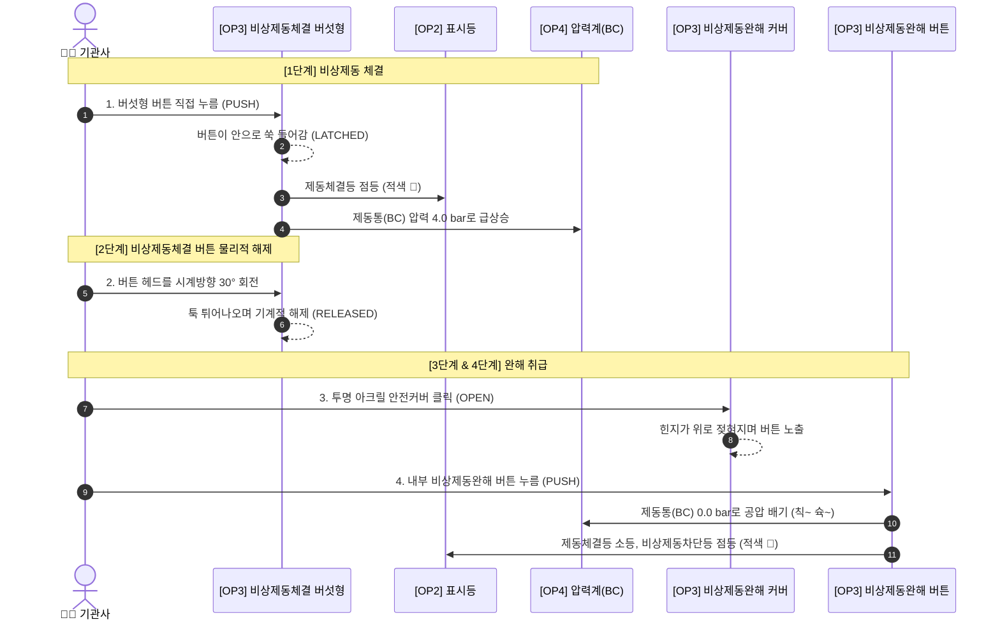

# 📖 3. 운전 취급 절차 매뉴얼 (Operating Manual)

본 매뉴얼은 실제 도시철도 운전 취급 규정에 기반하여 본 시뮬레이터에서 연습할 수 있는 핵심 절차와 인터록 제약 사항을 기술합니다.

---

## 1. 운전모드 `OFF` 상태 인터록 및 무인운전(ATO) 가동 절차

운전모드가 `OFF`일 때의 운전대 보호 인터록과 3초 롱프레스를 통한 무인운전 인가 표준 절차입니다.

### ① 운전모드 `OFF` 인터록 (운전대 잠금)
* 운전모드가 `OFF`인 상태에서는 기관사 수동 조작을 차단하기 위해 **제어키 ON 불가**, **전후진제어기(F/R) 조작 불가**, **마스콘(P1~P4, B1~B7, EB) 조작 불가** 인터록이 작동합니다.
* 운전모드를 `OFF`로 전환하면 기존에 투입되어 있던 제어키는 `OFF`로, 역전기 및 마스콘은 `N`(중립)으로 강제 복귀합니다.

### ② 무인운전모드(ATO) 인가 4대 선행조건 및 3초 롱프레스
무인운전(ATO)을 가동하기 위해서는 반드시 아래의 **4대 선행조건**이 충족되어야 합니다.

```
[운전모드 = OFF] ──┐
[제어키 = OFF]   ──┼─► [OP3 무인모드 투명 안전커버 OPEN] ─► [버튼 3초 롱프레스] ─► [ATO 무인운전 가동!]
[역전기 = N]     ──┤                                                        (60 km/h 자동 주행)
[마스콘 = N]     ──┘
```

1. OP2 운전모드가 `OFF` 위치일 것
2. OP2 제어키가 `OFF` 위치일 것
3. OP1 전후진제어기가 `N`(중립) 위치일 것
4. OP1 마스콘 핸들이 `N`(중립) 위치일 것
5. **취급 요령**:
   - OP3 `SW_WIRELESS_COVER`(무인모드 안전커버)를 클릭하여 엽니다.
   - 내부 녹색 푸시버튼(`SW_WIRELESS_MODE`)을 3초 이상 누르고 있으면 원형 프로그레스가 충전되며 녹색 불(`LIT`)이 점등합니다.
   - 점등 즉시 열차가 자동으로 역행하여 **60 km/h 목표 속도로 자동 순항 주행**을 시작합니다.
   - 전면 모니터 OSD에는 `ATO 무인` 노치 태그와 `무인운전 (ATO)` 상태 배지가 표시됩니다.
   - 4대 조건 중 하나라도 미충족 시 버튼을 눌러도 충전되지 않으며 미충족 안내 토스트가 출력됩니다.

---

## 2. 수동 운전 모드 (`FM`, `RM`, `ATPM`) 취급 절차

기관사가 직접 열차를 수동으로 조작하여 역행/제동하기 위한 절차입니다.

1. **운전 모드 전환**:
   * OP2 `SW_DRIVE_MODE`를 `FM`(완전 수동), `RM`(제한 수동), `ATPM`(신호 수동) 중 하나로 회전시킵니다.
   * 수동 모드로 진입하면 가동 중이던 무인운전(ATO)은 안전을 위해 즉시 자동 해제됩니다.
2. **제어키 투입**:
   * 운전모드가 수동 모드인 상태에서만 OP2 제어키를 `ON` 위치로 돌릴 수 있습니다.
3. **전후진제어기 투입**:
   * 제어키가 `ON`인 상태에서 OP1 역전기 노브를 `F`(전진) 또는 `R`(후진)으로 설정합니다.
   * 역전기가 `F` 또는 `R`에 들어가면 OP2 `선두차지정` 황색등이 점등됩니다.
4. **마스콘 핸들 조작**:
   * 출입문이 닫히고(`lamp-door` 점등), 제동통 압력이 0.5 bar 미만인 상태에서 마스콘을 `P1`~`P4`로 당기면 열차가 부드럽게 가속합니다.
   * **RM(제한수동) 모드 속도 제한**: RM 모드에서는 P4로 최대로 당겨도 열차 속도가 **25 km/h로 자동 제한**됩니다.

---

## 3. 주행 속도 폭주 방지 및 안전 감속 논리

시뮬레이터 물리 엔진에는 오조작이나 내리막 구배로 인한 탈선 및 무제한 가속을 방지하는 삼중 안전장치가 내장되어 있습니다.

1. **내리막 구배 가속 캡핑**:
   * 내리막 구간(음의 구배, `gradeAcc > 0`)에서도 열차 속도는 현재 마스콘 노치의 목표 속도(`target`)를 초과하여 가속되지 않도록 `Math.min(target, ...)`으로 고정됩니다.
2. **고속 ➔ 저속 모드 전환 시 안전 감속력 보장**:
   * FM(80 km/h)으로 고속 주행 중 RM(25 km/h)으로 운전모드를 전환하거나 P노치를 내렸을 때, `decel = Math.min(rate, -2.5)` 감속력을 보장하여 `Math.max(target, ...)`로 확실하게 감속 수렴합니다.
3. **운전 모드별 절대 상한선 (Absolute Limit)**:
   * `RM` 모드: 25.0 km/h 절대 상한선
   * `FM` / `ATPM` 모드: 80.0 km/h 절대 상한선
   * 물리적 외란으로 상한선을 초과하는 즉시 초당 5.0 km/h의 강제 제동력이 인가되어 규정 속도 내로 신속히 복귀합니다.

---

## 4. 비상제동 체결 및 완해 표준 절차 (4단계)



1. **[1단계] 비상제동 체결**: OP3 적색 버섯형 버튼 누름 ➔ BC 4.0 bar 가압, [제동체결] 적색등 점등
2. **[2단계] 비상제동체결 버튼 해제**: 버섯형 헤드 재클릭 시 시계방향 회전하며 튀어나옴
3. **[3단계] 완해 안전커버 열기**: OP3 비상제동완해 투명 커버 클릭하여 개방
4. **[4단계] 완해 버튼 누름**: 내부 적색 버튼 클릭 ➔ 1초 공압 배기음과 함께 BC 0.0 bar 완해 및 [비상제동차단] 점등

---

## 5. 선두차지정 표시등 점등 조건

OP2 상부의 노란색 **`선두차지정`** 표시등은 아래의 **3가지 조건이 동시에 충족될 때만** 점등됩니다.

$$\text{선두차지정 점등} \iff (\text{운전모드} \in \{\text{RM}, \text{FM}, \text{ATPM}\}) \land (\text{제어키} = \text{ON}) \land (\text{역전기} \in \{\text{F}, \text{R}\})$$

* 운전 모드가 `OFF`인 경우 ➔ **소등**
* 수동 운전 모드(RM/FM/ATPM)이더라도 제어키가 `OFF`이거나 역전기가 `N`(중립)이면 ➔ **소등**
* 수동 모드 + 키 ON + 역전기를 `F`나 `R`로 넣는 순간 ➔ **즉시 황색 🟡 점등**

---

## 6. VOBC 리셋 버튼 롱프레스 취급 요령

* OP5의 `SW_VOBC_RESET`(노란색 버튼)을 길게 누르는 시간에 따라 차상 신호 리셋 범위가 달라집니다:
  * **2.0초 ~ 3.0초**: 해당차 단독 VOBC 리셋 진행
  * **5.0초 ~ 7.0초**: 전·후부 VOBC 전체 리셋 진행
  * **7.0초 초과**: 리셋 타임아웃 경고 발생

---

## 7. 주차제동 체결 시 역행회로 차단 및 주차제동BP 취급

주차제동은 일반 제동라인(BC)과 별도로 차량을 붙잡아 두는 제동으로, 자동차의 사이드 브레이크와 같은 역할입니다.

* **체결 (`주차제동체결`)**: 역행을 구성하는 회로가 차단됩니다. 다른 조건(키 ON, 운전모드, 출입문 등)이 모두 정상이어도 마스콘 P1~P4를 넣어도 역행하지 않으며, 전후진제어기를 `R`에 놓고 후진하는 것도 불가능합니다. 무인운전(ATO)도 출발하지 않습니다.
* **완해 (`주차제동완해`)**: 주차제동이 풀리고 역행회로가 복귀되어야만 운행할 수 있습니다.
* **완해 불능 시 조치 순서**:
    1. `주차제동완해` 버튼 취급
    2. 그래도 완해되지 않으면 해당차 `PBCB` 차단기를 차단(OFF)했다가 투입(ON)한 뒤 `주차제동완해` 취급, 그래도 안 되면 해당차 **주차제동 전자변**(차체 하부, OP3 실내등 아래 `전자변` 버튼) 완해측 수동 버튼을 강하게 누름 (공기가 짧게 빠지며 완해)
    3. 그래도 완해되지 않으면 후부 운전실로 이동하여 1·2번을 반복
    4. 그래도 완해되지 않으면 후부 운전실 OP5 `주차제동BP` 스위치를 `바이패스`로 절체 → 역행회로가 구성되어 운행 가능

$$\text{역행 가능} \iff \lnot\,\text{주차제동 체결} \lor (\text{주차제동BP} = \text{바이패스})$$

* 역행이 차단된 상태에서 마스콘을 역행으로 넣으면 HUD 경고와 ADU 로그(`PARKING BRAKE APPLIED` / `TRACTION INHIBITED`)가 표시됩니다.
* 완해 불능 상황(MR 압력은 정상)은 기본 시나리오 1번 "주차제동 완해 불능 시 주차제동BP 취급"에서 자동으로 주입되며(주차제동이 체결된 상태로 시작, 화면 좌측 상단 패널에 위 4단계의 세부 조치가 ✓로 표시됨), 관제(OCC) 패널의 **🚨 주차제동 완해 불능** 고장 인가 버튼으로도 재현할 수 있습니다.

---

## 8. MR(주공기) 압력 저하 시 비상제동·주차제동 및 주공기BP 취급

| MR 압력 | 차량 반응 | 운전 취급 |
| :--- | :--- | :--- |
| 6.0 bar 이상 | 정상 | - |
| 6.0 bar 미만 | **비상제동 체결** + **역행회로 차단** (ADU `MR PRESSURE LOW`) | 관제 보고 → 지시에 따라 OP3 `비상제동완해` + OP5 `주공기BP` 바이패스 → 최근역까지 운행, 승객 하차 후 회송 |
| 4.0 bar 미만 | 위 상태 + **주차제동 자동 체결** (스프링 제동, DU PB 점등). 주차제동완해 불가, 주차제동BP·주공기BP를 취급해도 자력 운행 불가 | 관제에 "현재 MR 압력이 4.0 bar 미만으로 비상제동 및 주차제동 체결된 상태로 구원연결을 요청합니다." 보고 → 구원연결 시행 |

* 6.0 bar 미만 비상제동은 6.5 bar 이상, 4.0 bar 미만 상태는 4.5 bar 이상으로 회복되어야 해소됩니다.
* 관제(OCC) 패널의 **🚨 MR 공기누설 (4.0~6.0 bar)** / **🚨 MR 공기누설 심화 (4.0 bar 미만)** 고장 인가 버튼으로 자유 모드에서도 재현할 수 있습니다.

---

## 9. TCMS 통신고장 (MC1 CU 통신고장) 조치

* **현상**: ADU 우측 하단 `TCMS` 글자가 빨간색, DU의 출입문과 그 아래 회색·파란색 기기 정보가 모두 노란 바탕 검은 글씨로 바뀌고, DU 메시지에 `MF 시간 MC1 CU 통신고장`이 현시됩니다.
* **조치**: 차단기반에서 CU 스위치 **CCUCB, CCUDOCB, CCUDICB**를 배전반별로 **MC1 차단 → MC1 복귀 → MC2 차단 → MC2 복귀** 순으로 취급합니다. 두 배전반 모두 세 스위치를 차단 후 복귀해야 복구되며, 하나라도 빠지면 복구되지 않습니다.
* 관제(OCC) 패널의 **🚨 TCMS 통신이상** 고장 인가 버튼으로 자유 모드에서도 재현할 수 있습니다.

---

## 10. DU / ADU 고장 (화면 꺼짐) 조치

* **DU 고장**: DU 화면 전체가 검게 꺼집니다. 해당차(취급 운전실) 차단기반의 **DUCB를 차단했다가 복귀**하면 화면이 다시 나옵니다.
* **ADU 고장**: ADU 화면 전체가 검게 꺼집니다. 해당차 차단기반의 **ADUCB를 차단했다가 복귀**하면 화면이 다시 나옵니다.
* 해당차는 현재 운행 방향의 선두 운전실입니다 (하선 MC1, 상선 MC2). 반대편 차의 차단기를 취급하면 복구되지 않습니다.
* 관제(OCC) 패널의 **🚨 DU 고장** / **🚨 ADU 고장** 버튼으로 자유 모드에서도 재현할 수 있습니다.

---

## 11. VOBC1 고장 시 자동 절체 및 해당차 VOBC 리셋

* 기본 활성 VOBC는 **VOBC1**이며, OFF 모드에서도 ADU 우측 하단 `VOBC 1` 뒤에 **Ⓐ**가 표시됩니다 (FM 모드는 VOBC 전원 차단 표시).
* FM 모드로 전환하면 VOBC 전원이 차단되어 **POSITION LOST** 상태가 됩니다. 이후 OFF 모드에서 무인운전을 인가해도 자동 운전이 되지 않으며, RM 모드로 위치 태그 2개를 지나야 무인운전이 가능합니다 (FM으로 다시 돌리면 통과한 태그 수는 0으로 초기화).
* **VOBC1 고장**: 정상인 VOBC2로 **자동 절체**되어 `VOBC 2`에 Ⓐ가 붙고, `VOBC 1`은 빨간 글씨, DU의 MC1 VOBC 칸은 빨간 바탕에 흰 글씨가 됩니다.
* **조치**: 관제 보고 → "해당차 VOBC 리셋" 지시 → 해당차(MC1) 차단기 **VOBCCB1, VOBCCB2, VOBCDICB를 모두 차단했다가 다시 투입** → VOBC1이 정상(녹색)으로 복귀합니다. 활성은 절체된 VOBC2가 유지됩니다.
* 관제(OCC) 패널의 **🚨 VOBC1 고장** 버튼으로 자유 모드에서도 재현할 수 있습니다.

---

## 12. OP5 고속도차단기동작 · PWM차단 취급 시 역행 차단

* OP5의 **고속도차단기동작** 또는 **PWM차단** 스위치 중 하나라도 취급(눌림, 점등)되어 있으면 수동 운전(FM·RM·ATPM)에서 마스콘을 역행으로 넣어도 역행하지 않습니다.
* 두 스위치를 모두 복귀해야 역행할 수 있습니다.
